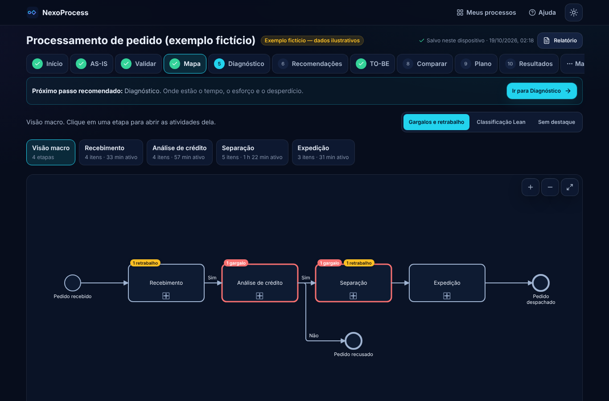

# NexoProcess (codinome)

Transforme uma planilha simples — ou algumas perguntas — em um **mapa BPMN navegável**, um **diagnóstico Lean** com fórmulas à vista, **recomendações rastreáveis**, um **cenário futuro (TO-BE)** comparável e um **plano de ação**, com relatório executivo. Tudo roda no navegador; os dados ficam no aparelho.



## Funcionalidades
- **V4:** identidade visual própria, navegação por jornada (barra lateral / barra inferior no celular), visão geral com próxima ação, desfazer, assistente conversacional com “Não sei” e texto livre, continuidade por arquivo de projeto, Lean com motivo de necessidade, casos conservador/base/otimista, responsabilidades alteradas e conclusão de ações com registro. Ver [docs/CHANGELOG_V4.md](docs/CHANGELOG_V4.md).
- **Entrada:** assistente conversacional (rascunho salvo) e formulário único; importação XLSX/CSV com mapeamento de colunas (PT/EN), prévia, validação por linha e detecção de reimportação; modelo XLSX protegido; exemplo fictício completo, com cenário ilustrativo.
- **Validação:** erros que bloqueiam × alertas; correções sugeridas só com confirmação; dados faltantes e o que cada um desbloqueia.
- **Mapa BPMN 2.0** (bpmn-js): macro por etapas → drill-down; decisões, retrabalho, paralelos; destaques de gargalo, retrabalho e crítica com o motivo; zoom, pan, pinça e ajustar à tela; tabela acessível por etapa; painel de detalhes.
- **Diagnóstico:** soma das durações × tempo decorrido × pessoa-hora; esforço e custo por período; Lean por duração; Pareto; carga por etapa e por responsável; gargalos com critério e limiar configuráveis; premissas explícitas.
- **Recomendações por regras** (sem IA): evidência (fato/inferência), regra, hipótese, ação, teto teórico, indicador, riscos; aceitar, rejeitar, editar ou investigar.
- **TO-BE assistido:** cópia independente; remover, simplificar, automatizar, combinar, reduzir espera ou retrabalho, com antes/depois, justificativa, hipótese e validador; vários cenários; premissas, investimento e custo recorrente.
- **Impacto da melhoria:** AS-IS × TO-BE, horas liberadas, capacidade, benefício bruto e líquido, payback, ROI, faixa otimista/pessimista, confiança qualitativa e meta aprovada.
- **Plano de ação**, **resultados reais** (realizado × base × previsão), **riscos/FMEA**, **RACI**, **simulação Monte Carlo** e **automação e IA**.
- **Exportações:** BPMN XML, SVG/PNG (ZIP), XLSX reimportável, CSV, backup JSON; relatório executivo imprimível em PDF.
- **PWA** instalável e offline; tema claro/escuro; responsivo; WCAG 2.2 AA verificado automaticamente com axe (não substitui teste com leitor de tela).

## Executar
```bash
npm ci                 # na raiz do repositório
npm run nexo:dev       # http://localhost:5180
npm run nexo:build     # typecheck + build em apps/nexoprocess/dist
npm run nexo:preview   # http://127.0.0.1:4180
```

## Testar
```bash
npm run nexo:test      # testes unitários (fórmulas, importação, modelo XLSX, BPMN, assistente, decisão, LibreOffice)
npm run nexo:e2e       # Playwright: jornada, assistente, V4, importação, exportações, 1440/768/390/320 + Android, PWA, a11y
node apps/nexoprocess/scripts/perf.mjs   # mede LCP/CLS/FCP (com o preview rodando em :4180)
DOCS_SHOTS=1 npx playwright test -c apps/nexoprocess/playwright.config.ts shots   # capturas da doc
```
Teste manual sugerido: “Ver demonstração fictícia” → Visão geral → Mapa (clique em “Separação”) → Diagnóstico (revisão Lean) → Oportunidades → Comparação (casos e responsabilidades) → Plano → Relatório. No celular: “Criar projeto” → assistente.

## Estrutura
```
src/domain/   modelo, unidades, grafo, métricas, validação, recomendações, TO-BE, comparação, simulação/RACI/FMEA (puro + testes)
src/io/       campos, leitura XLSX/CSV, mapeamento, modelo XLSX protegido, CSV
src/bpmn/     layout automático, XML BPMN 2.0 + DI, viewer (bpmn-js), render SVG/PNG
src/storage/  IndexedDB, backup/restauração
src/state/    workspace (autosave), tema, ações
src/pages/    landing, início, assistente, importação, ajuda, workspace/* (abas)
src/config/   marca, textos comerciais, glossário, manifesto
tests/e2e/    Playwright
docs/         CALCULOS, PRIVACIDADE, DEPLOY_CLOUDFLARE, COMERCIALIZACAO, ACEITE, CHANGELOG_V4, desempenho-medido.json
scripts/      ícones, medição de desempenho
```
Decisões técnicas: [`/docs/DECISOES_TECNICAS.md`](../../docs/DECISOES_TECNICAS.md).

## Publicar
Ver [docs/DEPLOY_CLOUDFLARE.md](docs/DEPLOY_CLOUDFLARE.md): build `npm run nexo:build`, saída `apps/nexoprocess/dist`, `NODE_VERSION=22`. **Ainda não publicado.**

## Limitações conhecidas
Junções paralelas não inferidas; tempo decorrido com decisões = pior caso; trava de estrutura do XLSX não preservada no LibreOffice (Excel a validar); dados só no navegador (faça backups); sem login, multiusuário ou IA generativa. Detalhes em [docs/ACEITE.md](docs/ACEITE.md) e [docs/COMERCIALIZACAO.md](docs/COMERCIALIZACAO.md).
